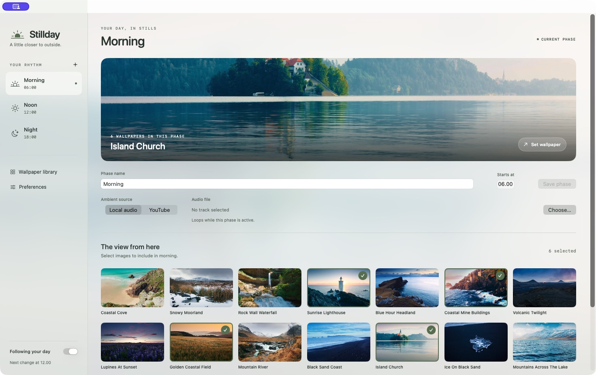
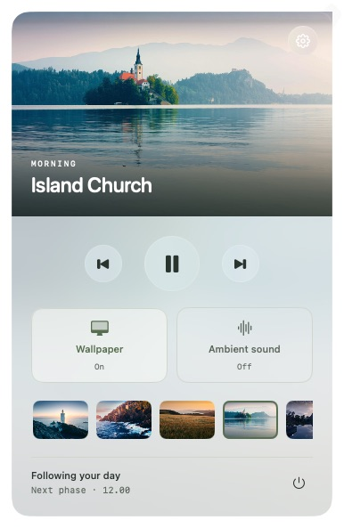

# Stillday

Your own photos, changing with your day. Stillday is a small Mac app that switches wallpapers on a schedule and can play ambient sound alongside them.

Inspired by [Portal](https://portal.app), with a focus on a few everyday controls and your own local collection.



*Preview with a personal photo collection. Wallpapers and audio are not included.*

## What it does

- Changes wallpapers through Morning, Noon, and Night, with names and times you can edit.
- Lets you pick the next wallpaper, pause the app, or switch sound on and off from the menu bar.
- Plays ambient audio in the background from local files or YouTube, with an optional visible YouTube player.
- Follows your Mac’s light or dark appearance, or lets you choose either manually.
- Uses the current wallpaper to tint its glassy interface.

<details>
<summary>See the menu-bar controls</summary>



</details>

## Install

You’ll need **macOS 14 or later**. There isn’t a prebuilt download on GitHub yet, so installation currently involves building the app on your Mac.

### 1. Install Apple’s build tools

Open **Terminal** and run the following, then finish the installer. Skip this step if you already have a recent Xcode or Command Line Tools installation with Swift 5.10 or later.

```sh
xcode-select --install
```

### 2. Build Stillday

Once the tools are installed, run:

```sh
git clone https://github.com/firdausbaihaqi/stillday.git
cd stillday
./scripts/install.sh
```

The installer builds Stillday, copies it into **Applications**, registers it with macOS, and opens it. Quit Stillday before running the installer again to update it.

You can reopen it from **Applications → Stillday**, or press **⌘Space**, type **Stillday**, and press Return. Opening it again restores Settings even when the app is already running in the menu bar.

This is an early build, signed locally rather than notarized by Apple. Enable **Launch at login** only after installing it.

## Set up your day

Stillday starts paused on a fresh installation.

1. Open **Wallpaper library → Choose folder** and select a folder of photos.
2. Choose a phase in the sidebar, then click the photos you want to include in it.
3. Edit the phase’s name or start time if you like, then choose **Save phase**. The defaults are 6 am, noon, and 6 pm.
4. Turn on **Enable Stillday** at the bottom of the sidebar.

Each phase lasts until the next one begins, using your Mac’s local time. The first assigned photo is selected when a phase starts; use the menu-bar arrows or thumbnails to choose another.

Your original photos stay where they are. Stillday remembers their locations, so keep the selected folder available.

## Add some sound

Sound is optional and has its own switch.

- **Local audio:** choose a phase, select **Local audio**, and use **Choose…** to pick a track. Turn on **Ambient sound** to loop it while that phase is active.
- **YouTube audio:** install [yt-dlp](https://github.com/yt-dlp/yt-dlp) once with `brew install yt-dlp` (requires [Homebrew](https://brew.sh)). Select **YouTube audio**, save a video link, and enable ambient sound. Audio plays automatically and keeps going with Settings minimized or closed. Stillday uses yt-dlp only to find the audio stream, then plays it through Apple’s native audio framework. It streams without saving a track to disk or keeping a video browser running.
- **YouTube player:** paste and save a video link, enable ambient sound, then press Play in the separate window. This uses YouTube’s embedded player, which must stay visible; closing it stops the sound. It works without yt-dlp.

YouTube requires an internet connection. Background audio uses unofficial extraction, so YouTube changes, restricted videos, or some live streams can prevent playback. If a stream expires or stops, switch sound off and on to reconnect. Try `brew upgrade yt-dlp` if extraction fails. Playlist links are not supported. Local audio is the most dependable option.

## Everyday controls

Click the menu-bar icon for quick controls. The gear opens Settings, and the power button quits the app.

Opening Stillday also shows **Controls** in its main window, with the same wallpaper, pause, and sound controls as the menu-bar panel. The sidebar keeps your phases and Preferences available.

Use the volume slider in either control surface to adjust audio from 0–100%. Both sliders and Preferences share the same saved volume, including for temporary tracks. You can set it before enabling sound.

Add local tracks in **Audio library**. Existing phase tracks appear there when older settings are loaded. Files stay in their original locations; removing a library entry keeps its file and saved phase assignments. Choosing a local track for a phase also adds it to the library.

With Stillday and Ambient sound enabled, choose an **Audio track** in either control surface to play it temporarily. This does not change the phase’s saved audio. The override survives pausing and closing the window, and ends at the next phase boundary, when you choose **Follow schedule**, or when you quit Stillday. Removing the selected library entry also returns playback to the phase audio. Scheduled local audio and YouTube sources remain available.

On macOS Tahoe, an enabled Stillday menu-bar switch can still be overridden by another app’s disabled entry. One verified case linked Stillday to ChatGPT’s **Allow in the Menu Bar** switch: enabling ChatGPT immediately restored Stillday, and disabling it hid Stillday again. If this affects you, check that switch in System Settings → Menu Bar. Stillday does not rewrite macOS’s permission records. See [verification notes](Verification.md) for the observed limits.

- **Wallpaper** and **Ambient sound** can be enabled independently.
- **Pause** stops scheduling and sound, leaving the current wallpaper in place.
- Settings appears in the Dock and **⌘Tab** while its window is open. **⌘W** minimizes it while sound keeps playing; open Settings again to restore it. Closing the window hides the Dock icon and keeps Stillday in the top menu bar, with background audio running. Use its menu-bar gear, Applications, or Spotlight to reopen Settings.
- **Preferences** contains appearance, volume, and launch-at-login options.

Quitting also leaves the last wallpaper in place; Stillday does not automatically restore your previous wallpaper.

## For developers and curious readers

Built with Swift and Apple’s native frameworks. Background YouTube audio optionally uses the separately installed yt-dlp command-line tool; the app has no third-party Swift packages.

- [Learn the app through its commits](docs/LEARNING_PATH.md)
- [Read the test results, performance measurements, and current limitations](Verification.md)
- Run the regression checks with `swift run StilldayChecks`. After building, run native checks with `./scripts/smoke-test.sh --audio-fixture=/absolute/path/to/test.wav`; the fixture uses a separate app identity and muted audio.

Settings are stored in `~/Library/Application Support/Stillday/settings.json`. Personal settings, photos, and audio are not stored in this repository.
