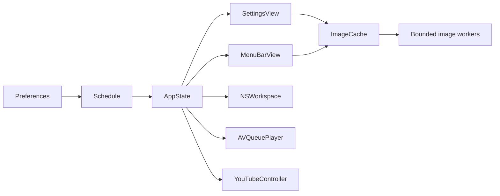

# Learning Stillday through its commits

The first implementation was published as one large commit. This learning history was reconstructed from the earlier conversation and saved source snapshots, then compiled and checked chapter by chapter. Commit dates record the reconstruction.

The sequence follows the requests: a minimal Portal-inspired app using local wallpapers; three editable phases; native performance and local/visible-YouTube audio; measured navigation improvements; system/manual appearance and photo-backed controls; then keyboard minimization, motion, and wallpaper-derived glass.

## Chapters

| Step | Commit | What to learn | Verified |
| --- | --- | --- | --- |
| 01 | [`190bd30a`](https://github.com/firdausbaihaqi/stillday/commit/190bd30a9e9be9964e8757568bcd52cc3d7a66cb) · feat(core): model phases and test scheduling | Start with pure scheduling, validation, media metadata, URL validation, and JSON persistence. Keep macOS UI and playback out of the domain layer. The standalone checks work with Command Line Tools. | 36/36 core checks |
| 02 | [`ea301a2d`](https://github.com/firdausbaihaqi/stillday/commit/ea301a2dfc1a2e615e59b8a9599a80f150dc70ba) · feat(mac): add wallpaper scheduling and settings | Connect the tested core to AppKit: a menu-bar host, wallpaper folder selection, per-phase assignments, editable times, and a dedicated SwiftUI window. The same local files are referenced in place. | 36/36 core checks + native build |
| 03 | [`3bdbfc66`](https://github.com/firdausbaihaqi/stillday/commit/3bdbfc6655e5e9b6867b20354b07625b22985236) · feat(audio): loop local ambient tracks natively | Add independent audio controls and per-phase local tracks using AVQueuePlayer and AVPlayerLooper. Keep playback buffered and stop it on master pause or sleep. The UI exposes only the supported local source at this point. | 36/36 core checks + native build |
| 04 | [`15e5a0fd`](https://github.com/firdausbaihaqi/stillday/commit/15e5a0fd341cdd18b87613f800dc7e385fcb182e) · feat(youtube): add an optional visible player | Add the official YouTube embed on demand, validate video links, and release its WebKit session when stopped. A visible player is required; local audio remains the background option. | 36/36 core checks + native build |
| 05 | [`502b6359`](https://github.com/firdausbaihaqi/stillday/commit/502b63598a8222a2f116d967560c5c3b28222923) · perf(images): move decoding off the main thread | Reproduce the navigation stalls, then move ImageIO onto two bounded actors and share pending requests. Add a diagnostic benchmark and retain path-free before/after data. This is the key concurrency/performance chapter. | 36/36 core checks + native build |
| 06 | [`0202608d`](https://github.com/firdausbaihaqi/stillday/commit/0202608d242fbf651252e48c883ed36bc34cd764) · feat(appearance): follow system or choose light and dark | Introduce semantic adaptive colors, an appearance preference, and backward-compatible settings decoding. Add regression checks for migration and all three appearance modes. | 45/45 core checks + native build |
| 07 | [`6f1a667f`](https://github.com/firdausbaihaqi/stillday/commit/6f1a667f80c2fc8687ff593e4f9adb5d0ccf8193) · feat(menu): add photo-backed quick controls | Replace the plain menu with a native popover, transport controls, wallpaper thumbnails, and separate wallpaper/audio switches. This checkpoint reproduces the previously published 0.2 source tree. | 45/45 core checks + native build |
| 08 | [`a8d574c9`](https://github.com/firdausbaihaqi/stillday/commit/a8d574c97d4a3b87107e6c1960f4c2aed867aa46) · feat(window): minimize and restore settings with command-w | Register a native window shortcut, retain background scheduling, dismiss the popover appropriately, and restore minimized windows from Settings. Extend the native smoke check with minimize/restore assertions. | 45/45 core checks + native build |
| 09 | [`512604a9`](https://github.com/firdausbaihaqi/stillday/commit/512604a948c2db29a7bdf2a9a440184ac3d95033) · feat(motion): animate navigation and control feedback | Add short page transitions, a shared selection indicator, hover/press springs, image fades, selection feedback, symbol replacement, and input focus feedback. Respect Reduce Motion and avoid continuous animation loops. | 45/45 core checks + native build |
| 10 | [`51de03c1`](https://github.com/firdausbaihaqi/stillday/commit/51de03c17528406583e5b7333e35be35d89a79df) · feat(glass): tint app surfaces from the active wallpaper | Use one cached, downsampled wallpaper for zoomed static blur and adaptive light/dark veils behind both windows. Keep text readable, ignore hit testing, and honor Reduce Transparency. | 45/45 core checks + native build |
| 11 | [`639c41f3`](https://github.com/firdausbaihaqi/stillday/commit/639c41f3aa8752979291c2cdeaefb384ccf743e1) · test(navigation): isolate benchmark setup from animated teardown | Start cold runs on a non-image page and disable animation only during test preparation. Avoid clearing the cache beneath retained outgoing views. Production transitions remain enabled. The full navigation replay then loads every expected image with zero main-thread decodes. | 45/45 core checks + native build |

The seventh checkpoint has exactly the same Git tree as the previously published 0.2 source. Later checkpoints introduce the requested changes. Historical checkpoints were compiled and their core checks were run; the complete UI was exercised on the final build.

## Read a chapter without changing your checkout

```sh
git log --reverse --oneline
git show <commit> --stat
git show <commit> -- Sources/
git worktree add --detach ../stillday-study <commit>
cd ../stillday-study
swift run StilldayChecks
```

Chapter 1 contains only the core. From chapter 2 onward, `swift build -c release --product Stillday` checks the native executable. `swift run Stillday --smoke-test` opens a temporary, non-desktop-writing smoke session. Use historical application snapshots with isolated diagnostics because they share the normal app’s settings location and bundle identity.

## Follow the data



- [Models.swift](../Sources/StilldayCore/Models.swift): pure phase/time rules, validation, and JSON persistence.
- [AppState.swift](../Sources/Stillday/AppState.swift): connects those rules to native desktop and audio APIs.
- [ImageCache.swift](../Sources/Stillday/ImageCache.swift): see how main-thread cache access and worker decoding are separated.
- [Theme.swift](../Sources/Stillday/Theme.swift): maps System/Light/Dark to native appearance and semantic colors.
- [Interaction.swift](../Sources/Stillday/Interaction.swift): shared finite animation and feedback policies.
- [WallpaperGlass.swift](../Sources/Stillday/WallpaperGlass.swift): a small cached image, static blur, and readable adaptive veils.

## Why these boundaries matter

1. Scheduling stays deterministic and testable without launching a GUI.
2. Static wallpapers are handed to macOS; the app does not render a desktop loop.
3. Local audio stays native. The visible YouTube player is optional and is created on demand.
4. Image decoding is expensive even when called from a `.task`; the actor/executor determines whether it blocks input.
5. Animation preserves outgoing views temporarily, so test fixtures must avoid cancelling loads beneath them.
6. Motion is finite, respects Reduce Motion, and leaves the app quiet when idle. Reduce Transparency provides an opaque surface.

The raw performance reports and limitations are in [Verification.md](../Verification.md). The original single-commit history was retained in a separate local Git bundle before the remote rewrite. To recover it into a separate branch, use `git fetch /path/to/Stillday-before-rewrite.bundle main:recovery/original-main`.
